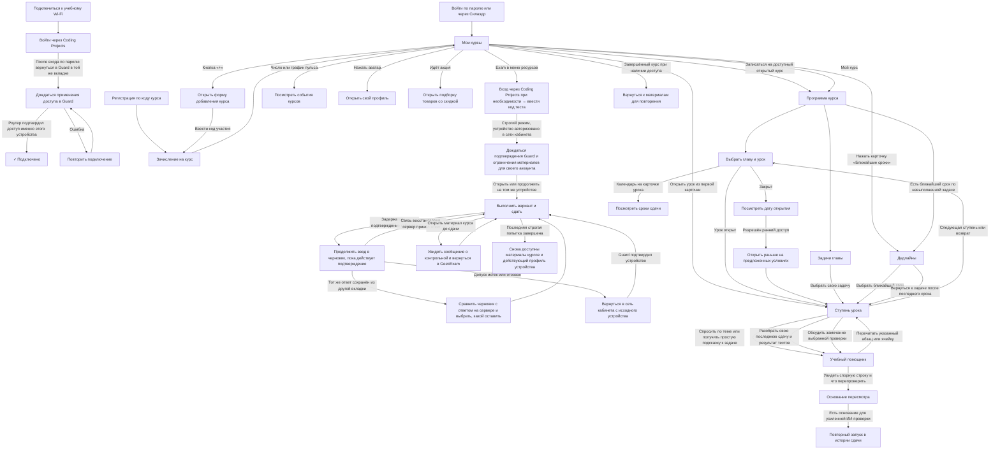
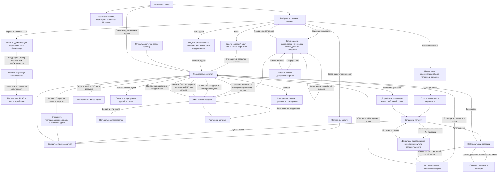
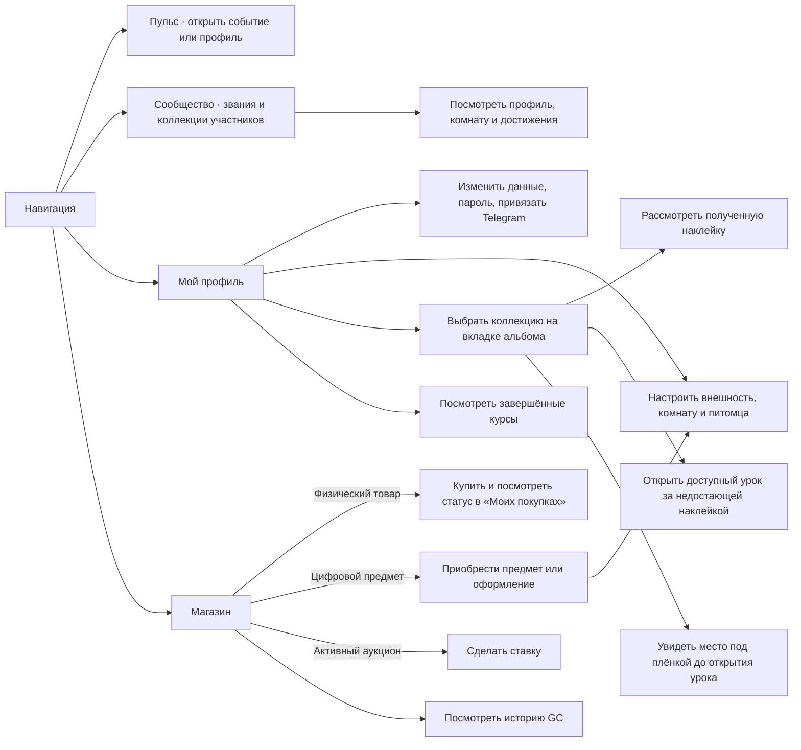
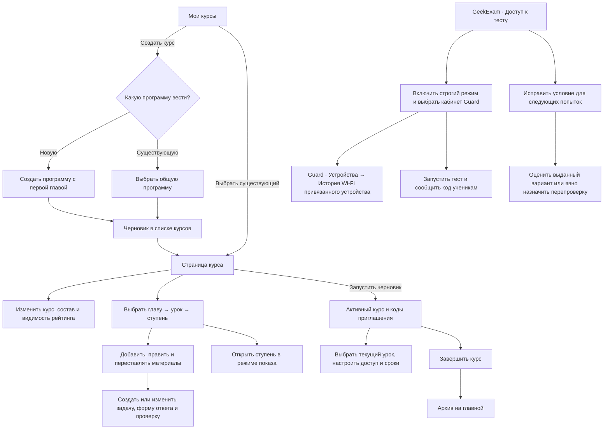
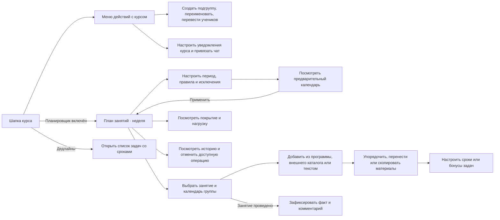
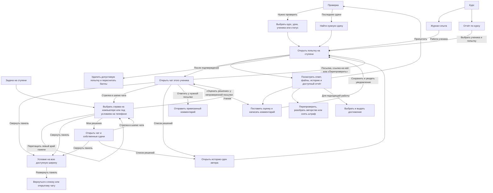
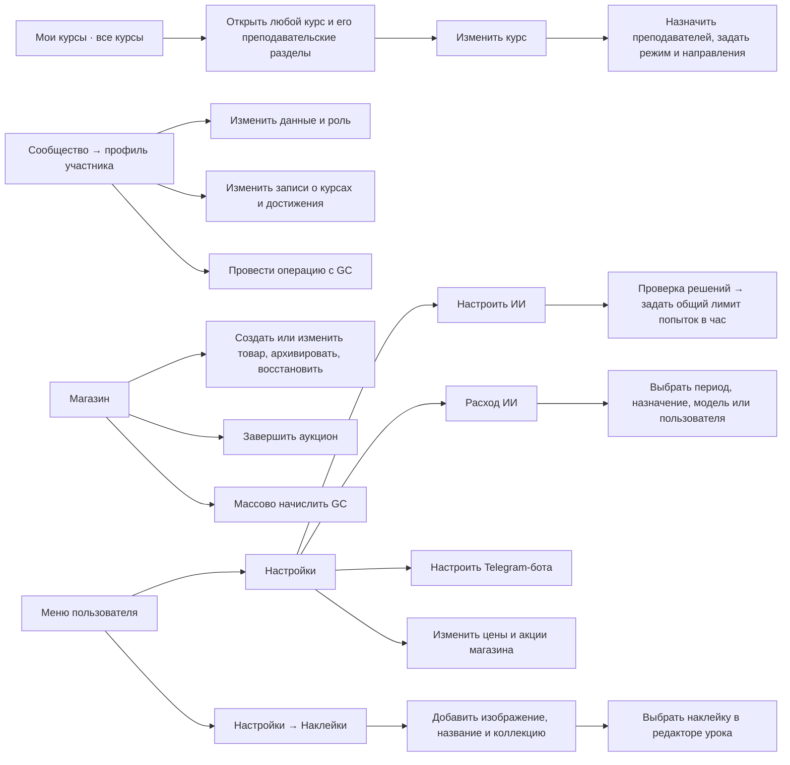
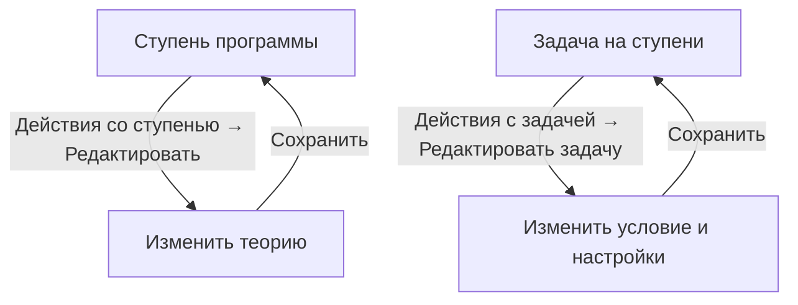

# CodingProjects · граф действий по ролям

Рабочий срез на **21 ноября 2026 года**. Карта описывает интерфейс локальной копии GeekClass, включая незакоммиченные изменения поверх `58b06cd`. Стрелка означает доступный переход, действие или его результат. Подпись на стрелке задаёт условие. Развилки показывают альтернативы, а обратные стрелки — куда человек может вернуться.

[Ученик](#student) · [Сдача и разбор](#submission) · [Личный кабинет](#personal) · [Преподаватель](#teacher) · [План и журнал](#planning) · [Проверка работ](#review) · [Администратор](#admin) · [Ревью программ](#materials) · [Обновление карты](#maintenance)

## Как устроена система

| Объект | Что он определяет для пользователя |
| --- | --- |
| Программа → глава → урок → ступень → задача | Программа содержит материалы. Ступень — рабочая страница теории и практики. Одной программой могут пользоваться несколько курсов. Правка общей задачи затрагивает курсы этой программы. |
| Курс → состав → подгруппа | Курс связывает программу с преподавателями, учениками, доступом и сроками. У подгруппы могут быть собственные даты и текущий урок. Перевод внутри курса сохраняет работы и оценки. |
| Задача → попытка → проверка | Одна задача допускает несколько попыток в пределах её правил. Для кода попытка может иметь несколько запусков проверки. Преподаватель открывает конкретную попытку ученика в контексте курса и задачи. |
| Аккаунт → профиль → кошелёк | Профиль, покупки и история GC принадлежат человеку. Курс определяет, например, может ли преподаватель провести операцию с GC в профиле этого ученика. |

Системная навигация ведёт в «Мои курсы», «Пульс», «Магазин», «Сообщество», «Профиль». У преподавателя и администратора есть также «Проверка». Ссылки на Storage, Exam, Arena и CodeBattle в меню ресурсов открывают другие приложения. Если на сервисе ещё нет сессии, он запускает вход через Coding Projects и возвращает пользователя на запрошенную страницу. [Вход в сервисы](../service-login.md) · [Навигация](../../app/Support/WorkspaceNavigation.php) · [Меню ресурсов](../../resources/views/layouts/partials/sidebar-user-resources.blade.php) · [Проверка принадлежности материала курсу](../../app/Services/CourseAccess.php).

| Где расходятся действия | Ученик | Преподаватель | Администратор |
| --- | --- | --- | --- |
| Вкладки курса | Программа, дедлайны, задачи главы | На своём курсе также план занятий (если включён), журнал и отчёт. «Задачи главы» — ученическая вкладка | Разделы управления любым курсом |
| Попытка | Свой ответ, результат и доступная обратная связь | Свой ответ либо проверка работы ученика своего курса | Проверка работ по всем курсам |
| Состав курса | Запись по приглашению или на открытый курс | Ученики своего курса и подгруппы | Также назначение преподавателей, направления и режим курса |
| Магазин и GC | Покупки, ставки и свой кошелёк | Обработка заказов, операция с GC в профиле своего ученика | Также каталог товаров, цены, акции и массовое начисление |
| Материалы | Чтение открытого, собственные сдачи | Прямая правка программы через свой курс | Также сравнение и публикация редакций в «Ревью программ» |

## Ученик · от входа до урока

При обычной регистрации код провайдера создаёт преподавателя, код курса зачисляет ученика. Уже вошедший пользователь может присоединиться по приглашению. Публичная ссылка `/open/steps/{id}` отдельно открывает материалы публичного урока. Подтверждение почты и привязка школьного аккаунта зависят от способа входа и состояния аккаунта. [Регистрация](../../app/Http/Controllers/Auth/RegisterController.php) · [Зачисление](../../app/Services/CourseEnrollment.php) · [Открытая ступень](../../app/Http/Controllers/OpenStepsController.php).

В шапке курса ученик видит «Программу» и «Задачи главы». Вкладка «Дедлайны» доступна в шапке, пока есть ближайший срок по невыполненной задаче. Закрепление текущего урока задаёт, что предложить ученику. Доступ определяется отдельно. Старый адрес `/planner` у записанного ученика при включённом планировщике перенаправляет в «Дедлайны». В «Ближайших» видна следующая дата сдачи, в «Пропущенных» — задачи, у которых прошёл последний срок и которые ещё можно сдать. Карточка задачи в разделе дедлайнов ведёт прямо к задаче. [Шапка курса](../../resources/views/components/gc-course-header.blade.php) · [Карточка сроков на главной](../../resources/views/components/gc-deadline-preview.blade.php) · [Перенаправление](../../app/Http/Controllers/CoursePlanner/PlannerController.php) · [Личные сроки](../../resources/views/courses/deadlines.blade.php).

На карточке урока календарь жёлтый в день первого срока и красный после его окончания. Он показывает сроки, которые действуют для задач. Если срок задан отдельно, календарь показывает его рядом с названием задачи. Для ученика учитываются доступные задачи, по которым ещё нужна сдача. Преподаватель видит состояние по расписанию курса или выбранной подгруппы. [Календарь урока](../../resources/views/courses/partials/lesson-deadline.blade.php).

## Ученик · сдача, ожидание и следующий шаг

Встроенная сдача показывает способы, разрешённые автором задачи, например редактор, файлы или репозиторий. В отчёте можно изучить тест, при разрешённой покупке открыть его данные за GC, вернуться в редактор или скачать исходник. У заблокированной задачи форма сдачи сообщает о блокировке. [Рабочая область](../../resources/views/steps/partials/native-workspace.blade.php) · [Форма обычной сдачи](../../resources/views/steps/partials/task_solution_form.blade.php) · [Правила и состояния](task-checking-flows.md).

Оценка проверки, начисленный XP и состояние «зачтено» отображаются раздельно. Поздняя правильная сдача может закрыть задачу на 10/10 и принести 7 XP. При доступности опций ученик может оплатить снятие штрафа или применить XP-бустер. Ожидание ручной проверки, техническая ошибка и доработка после комментария ведут к разным действиям. [Состояния карточки урока](../../tests/Feature/RoleLessonCardsTest.php) · [Правила сроков](../deadlines-and-classroom-bonuses.md) · [Запрос перепроверки](../../app/Services/SolutionRecheck.php).

GeekKaggle принимает прогнозы только в опубликованных соревнованиях. Администратор может открыть скрытое соревнование и посмотреть прежний рейтинг. [Маршруты соревнований](../../../GeekKaggle/kaggle.py) · [Настройка видимости](../../../GeekKaggle/templates/competition_editor.html).

## Ученик · профиль, сообщество и покупки

В курсе также можно посмотреть рейтинг, если преподаватель разрешил его показ. Личная история GC и редактирование аккаунта зависят от владельца профиля и полномочий смотрящего. Заказы обрабатываются со стороны преподавателя или администратора. [Профили](../../app/Http/Controllers/ProfileController.php) · [Магазин](../../resources/views/market/index.blade.php) · [Видимость рейтинга](../../tests/Feature/CourseLeaderboardVisibilityTest.php).

## Преподаватель · подготовка и проведение курса

Этот и следующие два преподавательских графа применяются также к администратору. Для преподавателя управление требует назначения на конкретный курс. На главной активные курсы, черновики и архив имеют отдельные списки.

Преподаватель может импортировать материалы в настройках курса, создать плакат программы, задать главу по умолчанию, открывать уроки по датам и выдавать ранний доступ. В редакторе ступени есть теория и вопросы. У задачи настраиваются форматы ответа, для кода — файлы, критерии и тесты. Экспорт материалов и баллов доступен в контексте курса, главы или урока в зависимости от формата. Настройки участников самого курса и перевод между подгруппами — два отдельных действия. [Создание и жизненный цикл](../../app/Http/Controllers/CoursesController.php) · [Меню главы](../../resources/views/courses/partials/program-actions.blade.php) · [Действия урока](../../resources/views/courses/partials/lesson-actions.blade.php) · [Редактор заданий](../../tests/Feature/TaskAuthoringTest.php).

В редакторе задачи режим «Тесты → ИИ» открывает настройки именованных групп и шкалу критериев ИИ. Преподаватель может открыть журнал тестов и разбор критериев выбранной посылки, повторить проверку или оценить работу вручную. [Задача, сдача и проверка](task-checking-flows.md).

## Преподаватель · план занятий, сроки и состав

«Журнал» в шапке курса показывает **опыт учеников**. Запись о проведённом занятии создаётся **в планировщике** и сохраняет снимок материалов и сроков. Обновление плана оставляет этот снимок доступным. Управление собственными сроками уроков и задач использует те же правила, что и планировщик. При редактировании срока урока по умолчанию включена замена индивидуальных сроков обычных задач. Снимите флажок, чтобы сохранить индивидуальные сроки. Для подгрупп можно задать отдельный календарь. Внешний каталог зависит от настроек конкретного провайдера. [Редактор сроков](../../resources/views/components/deadline-editor.blade.php) · [Планировщик и команды](../course-planner-implementation.md) · [Подгруппы](../course-subgroups.md) · [Действия в меню курса](../../resources/views/courses/partials/course-actions.blade.php).

## Преподаватель · проверка работ и результаты

На странице задачи преподаватель выбирает ученика или пункт «Мои решения». Каждый пункт открывает соответствующий чат, а стрелка в его шапке возвращает к выбору. Ссылка на проверку хранит ученика, задачу и попытку. На компьютере список и чат занимают всю высоту справа от условия. На телефоне список расположен под условием, а чат открывается на весь экран. Редактирование ступени и добавление задания доступны в меню «…». Старый адрес проверки перенаправляет на ступень. Пропуск убирает работу из текущей очереди без новой оценки. Доступен также пропуск списка по фильтрам. Отдельно можно блокировать и разблокировать сдачу задачи конкретным учеником. Статистика урока, журнал XP и отчёт по ученику дают разные входы в результаты. [Адрес конкретной попытки](../../app/Services/TaskLocation.php) · [Очередь](../../resources/views/courses/reviews.blade.php) · [Действия в проверке](task-checking-flows.md) · [Удаление попытки](../../app/Services/SolutionRemoval.php).

Вне курса преподавателю доступны выдача и отмена ожидающих заказов магазина. В профиле ученика своего курса он может провести операцию с GC, а для достижения своего курса — изменить описание. [Заказы](../../app/Http/Controllers/MarketController.php) · [Права в профиле](../../app/Http/Controllers/ProfileController.php).

## Администратор · дополнительные действия

Во вкладке «Расход ИИ» администратор видит сумму входных и выходных токенов, число вызовов без полного счётчика и разбивку по назначению, модели и пользователю. Строка в таблице уточняет фильтр для всего отчёта. Доступ проверяют `auth` и `admin`. [Отчёт о расходе ИИ](../../resources/views/settings/ai-usage.blade.php) · [Проверка доступа](../../app/Http/Controllers/AiUsageController.php).

У администратора есть также служебные входы по прямым адресам. Это `/insider/room-debug` для редактора раскладки комнаты и `/insider/settings/code-executor/…` для статуса, входа в GeekExecutor и выгрузок прежних проверок. Привязка личного Telegram в профиле, чат курса и настройка системного бота имеют разные точки входа и права. [Вкладки настроек](../../resources/views/settings/partials/tabs.blade.php) · [Поля курса для администратора](../../resources/views/courses/edit.blade.php) · [Служебные маршруты](../../routes/code-checking.php) · [Редактор комнаты](../../app/Http/Controllers/RoomDebugController.php).

## Преподаватель и администратор · редактирование материалов

Сохранение в штатном редакторе сразу обновляет текущую теорию или задачу для курсов этой программы. Сохранённое условие прежней сдачи доступно по ссылке на историю попытки. [Редактор ступени](../../resources/views/steps/edit.blade.php) · [Редактор задачи](../../resources/views/steps/edit_task.blade.php) · [История сдачи](../../app/Http/Controllers/MaterialHistoryController.php).

## Как поддерживать граф

Эти восемь диаграмм редактируются прямо в Markdown. При изменении действия обнови в соответствующем графе вход, условие видимости, результат и обратный путь. Если меняется роль, проверь обе стороны перехода по шаблону и серверной проверке прав. Ссылки под каждым графом ведут к реализации или профильному тесту.

Полная UX-карта хранит техническую детализацию. При изменении маршрута или владельца экрана обнови [system-map.json](system-map.json), выполни `rtk proxy npm run ux:build`, затем `rtk proxy npm run ux:check`. Эти команды пересобирают и проверяют [список маршрутов](routes.md), [атлас экранов](screens.md) и [обзор переходов](graph.html). Ролевые диаграммы остаются редактируемым описанием пользовательских сценариев.

**Проверка среза 21 ноября.** В изолированной копии Laravel зарегистрировал 249 маршрутов. Проверка UX-карты подтвердила 47 экранов, 118 узлов и 265 переходов. Это числа технического атласа. Из 121 выбранного функционального теста прошли 118. При чтении ролевого графа существенны три расхождения:

- Тест навигации ожидает у ученика четыре вкладки. Отрисованный компонент выводит три. В графе показаны три. [Тест](../../tests/Feature/CourseWorkspaceNavigationTest.php) · [Компонент шапки](../../resources/views/components/gc-course-header.blade.php).
- Проверка старой ученической ссылки на планировщик проходит до перенаправления включительно. Последующая отрисовка шапки в тесте прерывается из-за отсутствующей таблицы раннего доступа в тестовой базе SQLite. [Сценарий перенаправления](../../tests/Feature/CoursePlannerTest.php).
- В сценарии с пустым кешем баллов тест карточки урока ожидает элемент `progressbar`, которого нет в полученном HTML. Этот сценарий отображения процента остаётся неподтверждённым. [Тест карточки](../../tests/Feature/RoleLessonCardsTest.php).
