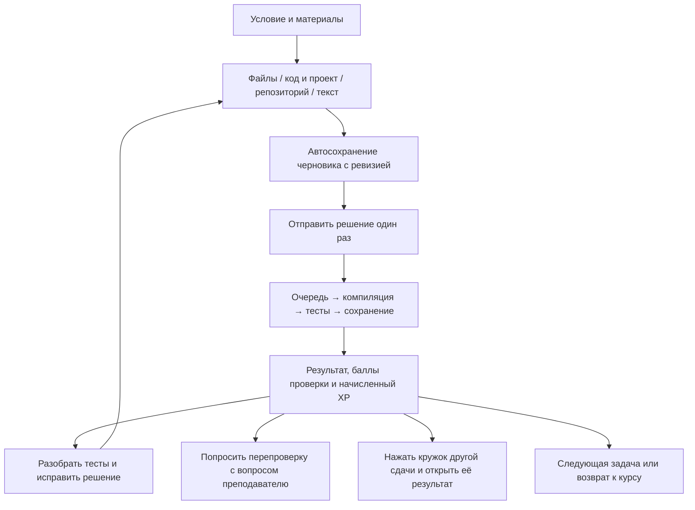

# Задача, сдача и проверка

Выбран второй вариант макета: «Условие рядом» для ученика и «Код и оценивание»
для преподавателя. Оформление продолжает B+: спокойные поверхности и навигация
из Linear, ясный рабочий контекст из Discord, акцентные награды и прогресс Арены
и «Пути проекта». Цвета приходят из настроенной темы.

## Ученик

Под вкладками ступени ученик видит название задачи, пометку о необязательности и награду в GC, если они предусмотрены. Справа стоит лучший результат проверки по всем посылкам. Он виден при первом открытии задачи и обновляется при проверке. Ученик может отправить ещё одну версию и вернуться к предыдущей через чат. Результат конкретной посылки доступен по её прямой ссылке.

В квизе вопрос и варианты или поле ответа идут в одной колонке. После сдачи видны ответ ученика, комментарий и XP. Если остались попытки, форму можно открыть через «Ответить ещё раз». История ответов открывает выбранную попытку. У преподавателя под вопросом есть список «Ответы учеников».

В личном чате задачи ученик видит свои посылки, отдельные запуски проверки и сообщения педагогов курса. Вопрос можно отправить до первой сдачи или привязать к посылке стрелкой ответа. Нажатие на файл открывает его содержимое, а «Журнал тестирования» открывает отчёт выбранного запуска. Исходники из старого GeekPaste с неизвестной версией помечены как сохранённые версии. Вопрос в чате не создаёт заявку на перепроверку.

| Проверка | Что видно в чате | Действие |
| --- | --- | --- |
| Преподаватель | Подтверждение получения до проверки, затем баллы и комментарий | «Оценить решение» у преподавателя открывает форму выбранной посылки |
| ИИ по критериям | Общий вывод, итог и строка на каждый критерий с результатом и баллами, если у критерия есть вес | «Подробнее» открывает пояснение по каждой строке |
| Тесты | Количество пройденных тестов и двухцветная полоса. При ошибке компиляции виден текст диагностики | «Подробнее» открывает журнал этого запуска и разрешённые для покупки скрытые тесты |

На компьютере сразу под названием слева идут файлы и текст, справа начинается чат. Кнопка «Сдать решение» под текстом открывает редактор. В разделе «Баллы и прогресс урока» можно посмотреть условия начисления баллов и срок. На телефоне файлы, текст и примеры также видны при открытии задачи. Наклейка видна на карточке урока в курсе и в альбоме профиля.

Разрешённые способы объединены в «Файлы», «Код» и «Репозиторий»; при единственном
способе переключателя нет. Текстовая работа содержит ответ и разрешённые вложения.
Код и проект отличаются числом файлов. У одного исходника нет лишней вкладки
и поля имени; при добавлении второго файла появляются вкладки и переименование.
Фиксированный язык показан меткой. Двоичные и большие исходники сохраняются
без преобразования в текст, их можно скачать или явно заменить.

Автосохранение запускается через 900 мс после изменения, использует ревизии
и не пересоздаёт редактор. Отправка ждёт сохранение и блокирует повторный клик.
При конфликте можно скачать локальный черновик и явно загрузить серверный.
Переход к результату и обратно сохраняет редактор и набранный код.
Обычная текстовая форма открывается и во время загрузки истории сдач.
При задержке чата состояние загрузки видно над полем ввода. Если сервер
не ответил, переписку можно загрузить повторно.

В шапке результата каждый кружок открывает одну сдачу. Синие часы означают «На проверке»,
графитовый треугольник означает ошибку проверки, красный крест — «Не принято»,
охристый полукруг — частичный результат, зелёная галочка — полный. Цветная заливка
остаётся лёгкой, а внешняя обводка отмечает выбранную сдачу.
В окне отправленного решения кружки, время и баллы находятся в одной строке.
Результат обновляется автоматически по ходу проверки.
Пустая история скрыта. По прямой ссылке ученик видит название задачи и итог
выбранной попытки в одной шапке. Условие занимает левую колонку. В правой
есть выбор попытки, запись об отправке и обратная связь. Нажатие на запись
открывает исходную работу в диалоге. На телефоне по прямой ссылке на сдачу
условие можно развернуть над работой.
Если сдачу можно перепроверить, кнопка «Попросить перепроверить» рядом с действием
для новой сдачи открывает форму вопроса преподавателю. Статус отправленного запроса
появляется в окне результата и в чате задачи.
Данные отдельного теста загружаются при раскрытии; покупка скрытого теста сохраняет
его открытым. Право покупки и цена проверяются сервером.

## Преподаватель

Вкладки «Моё решение» и «Решения учеников» находятся вверху правой панели, над списком учеников или чатом.
Выбор ученика открывает требующую проверки, непросмотренную или последнюю попытку;
явная ссылка с `student`, `task`, `attempt` и `#task…` имеет приоритет.
Список учеников сохраняет поиск и положение при возврате. Чат можно открыть и до первой сдачи. Значок сообщения отмечает учеников, которые уже написали по задаче. Можно перейти к предыдущему или следующему ученику.

На широком экране код и отчёт находятся слева, оценка и обратная связь — справа.
Панель содержит баллы, комментарий, сохранение, «Сохранить и далее», пропуск одной
работы, запрос ученика, перепроверку и анализ авторства. На узком экране блоки идут
друг за другом. Несохранённая оценка и комментарий сохраняются при смене ученика
в пределах открытой страницы. Ошибка сохранения оставляет введённый текст.
Пропуск не меняет оценку; устаревший токен очереди не снимает новый запрос.

В чате преподавателя действие находится в карточке конкретной проверки. «Оценить решение»
открывает работу, ожидающую ручной оценки. «Перепроверить» у результата позволяет выставить
баллы и написать комментарий, повторить автотесты или выбрать усиленную модель для работы
с ИИ-проверкой. Новый результат появляется в переписке этой посылки. Ученик открывает
отчёт конкретного запуска из карточки проверки в чате.

В полном окне проверки также есть кнопка «Перепроверить усиленной моделью».
Модель выбирается администратором. Если она не настроена, кнопка недоступна
и причина указана рядом. Повторная проверка использует сохранённый исходник,
предыдущий запуск остаётся в истории. Обычная перепроверка позволяет явно выбрать
текущие настройки задачи.

Значок анализа авторства рядом с действиями открывает общий диалог отчёта. При предупреждении он выделен и содержит доступное название состояния. Отчёт содержит состояние, объяснение метода сравнения, сходство исходников, доступные похожие
работы и признаки помощи ИИ. Имя и каноническая ссылка показываются только для
работ в доступных преподавателю курсах. Автоматический анализ сам по себе
не меняет оценку; предупреждение можно снять и восстановить. Ученику закрытые
совпадения и диагностические материалы не передаются.

Собственная сдача преподавателя использует обычный черновик и отправку,
получает обычный опыт и награды. Роль преподавателя не добавляет его в список
учеников курса. Управление чужой оценкой не показывается в собственной работе.

## История, скорость и границы

Переключение попытки не вызывает принудительную прокрутку. Во время загрузки
прежний результат остаётся на месте под индикатором, затем заменяется целиком.
Запоздавший ответ не заменяет новый выбор; предыдущий запрос отменяется.
Кэш хранит до четырёх завершённых результатов на 15 секунд и сбрасывается после
изменения данных. Живые проверки не кэшируются. Прогресс сообщает точное число
выполненных тестов, без выдуманных процентов подготовки.

История выдаётся по 20 записей, подробности — по выбранной попытке. База выбирает страницу, считает число попыток и определяет лучшую оценку ученика по всей истории. Тесты показаны страницами по 10: номера страниц, переход назад и вперёд, диапазон текущей страницы. Последняя страница сохраняет высоту таблицы. Открытые данные тестов и текущая страница сохраняются при обновлении результата. Кэш DOM ограничен тремя страницами.
Первый исходник открыт сразу, файлы ZIP загружаются по выбору, длинный код
прокручивается внутри блока.

Баллы проверки и начисленный XP подписаны отдельно. Историческая сдача сохраняет
дату и XP. Если точная версия кода не была сохранена, доступная версия отмечена
как сохранённый код; её отчёт не подменяет результат исторической сдачи.
Отсутствующий фактический вывод не восстанавливается догадкой. Техническая ошибка
показывается без оценки с возможностью повтора, если сервер разрешает его.
Награды показывает общая очередь после фактического начисления, без дублей.

## Редактор задачи

Поля зависят от выбранного способа проверки: короткий ответ появляется только
в соответствующем режиме, критерии и параметры модели — у ИИ, тесты — у проверки
по тестам. Пустое авторское решение, эталонный ответ и модель с лимитом попыток
раскрываются по запросу. Фокус достижения появляется после включения награды.
У уже настроенной нативной задачи скрыт единственный вариант способа сдачи.

Расширения файлов показываются при разрешённой загрузке, точка входа — при сдаче
нескольких файлов, проекта или репозитория. Лимиты файлов скрыты для одного поля
кода и текстового ответа. Погрешности сравнения появляются только для вещественных
чисел, включая индивидуальное правило теста. Метаданные прикрепляемого файла
появляются после выбора файла; запрет изменения — только у шаблона, передача в ИИ —
только у ИИ-проверки. Переключения сохраняют значения в открытом редакторе.
Неиспользуемые настройки не отправляются, а сервер проверяет `test_config` только
для режима проверки по тестам, в том числе при сохранении перенесённых задач.

## Проверка

`php artisan test --compact`, `npm run build`, `npm run ux:check`.
`npm run ui:check -- --authoring-only` проверяет условные поля и сохранение настроек.
Браузерный сценарий `npm run ui:check -- --workspace-only` проверяет роли на 1440
и 390 px: автосохранение, возврат к черновику, раскрытие купленного теста,
запрос перепроверки, отмену загрузки, ZIP-историю, антиплагиат, усиленную
ИИ-проверку, оценивание, переход к следующей работе и собственную сдачу учителя.
Стенд использует синтетические базы и подменённые внешние вызовы.

Действия просмотра, оценки, сохранения и перехода представлены иконками
с доступными названиями и подсказками. Усиленная ИИ-проверка сохраняет явную
подпись, поскольку запускает отдельную проверку сохранённой работы.

Сдачи `.ipynb` открываются как тетрадка с Markdown, кодом и сохранённым выводом.
Доступны исходный JSON и скачивание неизменённого файла. До 8 МБ тетрадка
загружается через авторизованный маршрут, в том числе когда исходник не включён
в короткий DTO. Ячейки добавляются порциями по 50; код не запускается.
HTML вывода проходит существующую очистку; активные элементы удаляются.
Длинные имена и строки не расширяют рабочую область, широкие таблицы
прокручиваются внутри вывода.

## Переписка по задаче

Переписка принадлежит одному ученику, курсу и задаче. На компьютере от 992 px текст и чат стоят вплотную в общей области, между ними одна вертикальная линия. Чат занимает оставшуюся высоту окна, поле ввода находится у нижнего края. У длинного условия и переписки своя прокрутка. На более узком экране это две самостоятельные панели. Текст задачи остаётся виден и после сдачи.

События читаются из существующих посылок, проверок и оценок. Для вопросов и ответов нужна миграция `2026_11_21_180000_create_task_chat_messages`. Она создаёт таблицу сообщений и связи с обычными и историческими посылками. Один повторно доставленный запрос сохраняет одно сообщение. На PostgreSQL открытая переписка получает сигнал по приватному WebSocket после фиксации изменения. При подключении и восстановлении связи клиент перечитывает историю. Десятисекундная проверка служит запасным способом для SQLite и перерывов связи.

В пилотном курсе Ростислоп отвечает в том же чате задачи. Вопрос можно задать до первой посылки. Для обсуждения конкретного результата ученик отвечает на него стрелкой. Если ученик называет балл в чате, помощник выбирает соответствующую проверку или предлагает уточнить время. Бесплатные примеры открываются отдельным действием под результатом автотестов. После перепроверки ученик видит оба балла и предмет спора. Очередь Laravel готовит ответ в фоне. У ученика и преподавателя новая реплика появляется через Socket.IO. Ссылки под ней открывают нужный абзац конспекта. [Настройки и проверка](../../services/tutor/README.md).

На странице задачи с подключённым помощником ученик видит чат справа на всю высоту окна. Оглавление, вкладки и условие доступны слева. Под условием показаны отправленные решения с датами и результатами. По нажатию открывается окно выбранной сдачи с работой и проверкой. На узком экране ученик открывает чат кнопкой «Чат задачи» и возвращается кнопкой «К задаче» или клавишей Escape. Неотправленный текст остаётся в чате. Если ученик находится в конце переписки, новый ответ длиннее ленты показывается с начала.
