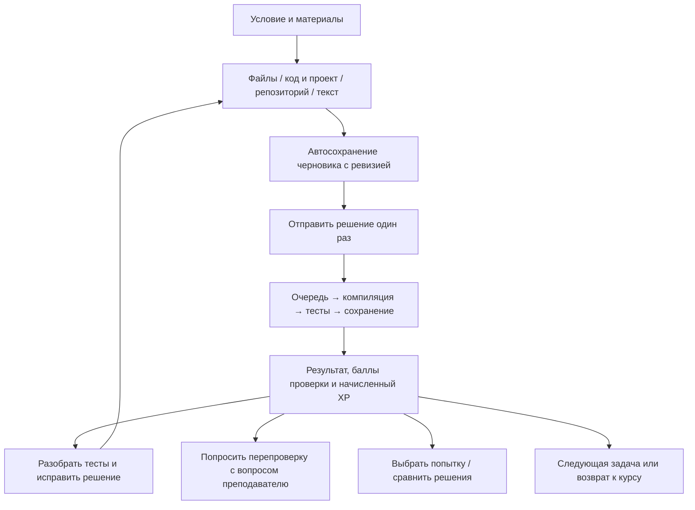

# Задача, сдача и проверка

Выбран второй вариант макета: «Условие рядом» для ученика и «Код и оценивание»
для преподавателя. Оформление продолжает B+: спокойные поверхности и навигация
из Linear, ясный рабочий контекст из Discord, акцентные награды и прогресс Арены
и «Пути проекта». Цвета приходят из настроенной темы.

## Ученик

На компьютере условие находится слева, рабочая область — справа. На телефоне
они идут последовательно. Заголовок показывает тип задачи, срок, XP и GC.
Если у урока есть наклейка и рассчитанный прогресс, рядом показаны его реальные
проценты и состояние наклейки; прежний порог получения выше 90% сохраняется.

Разрешённые способы объединены в «Файлы», «Код» и «Репозиторий»; при единственном
способе переключателя нет. Текстовая работа содержит ответ и разрешённые вложения.
Код и проект отличаются числом файлов. У одного исходника нет лишней вкладки
и поля имени; при добавлении второго файла появляются вкладки и переименование.
Фиксированный язык показан меткой. Двоичные и большие исходники сохраняются
без преобразования в текст, их можно скачать или явно заменить.

Автосохранение запускается через 900 мс после изменения, использует ревизии
и не пересоздаёт редактор. Отправка ждёт сохранение и блокирует повторный клик.
При конфликте можно скачать локальный черновик и явно загрузить серверный.
Переход к результату и обратно сохраняет редактор и набранный код.

Сохранённые попытки выбираются компактным списком; подробная история и переход
к лучшей сдаче доступны рядом. Пустая история скрыта. Исходник, тесты и результат
показаны в постоянной рабочей области, без вложенного аккордеона попытки.
Данные отдельного теста загружаются при раскрытии; покупка скрытого теста сохраняет
его открытым. Право покупки и цена проверяются сервером.

## Преподаватель

Условие свёрнуто над работой, вкладки «Решения учеников» и «Моё решение» сохранены.
Выбор ученика открывает требующую проверки, непросмотренную или последнюю попытку;
явная ссылка с `student`, `task`, `attempt` и `#task…` имеет приоритет.
Список учеников сохраняет поиск и положение при возврате. Ученик без сдач показан
без ссылки. Можно перейти к предыдущему или следующему ученику.

На широком экране код и отчёт находятся слева, оценка и обратная связь — справа.
Панель содержит баллы, комментарий, сохранение, «Сохранить и далее», пропуск одной
работы, запрос ученика, перепроверку и анализ авторства. На узком экране блоки идут
друг за другом. Несохранённая оценка и комментарий сохраняются при смене ученика
в пределах открытой страницы. Ошибка сохранения оставляет введённый текст.
Пропуск не меняет оценку; устаревший токен очереди не снимает новый запрос.

Для ИИ-проверки отдельно видны модель и кнопка «Перепроверить усиленной ИИ-моделью».
Модель выбирается администратором. Если она не настроена, кнопка недоступна
и причина указана рядом. Повторная проверка использует сохранённый исходник,
предыдущий запуск остаётся в истории. Обычная перепроверка позволяет явно выбрать
текущие настройки задачи.

Значок анализа авторства рядом с действиями открывает общий диалог отчёта. При предупреждении он выделен и содержит доступное название состояния. Отчёт содержит состояние, объяснение метода сравнения, сходство исходников, доступные похожие
работы и признаки помощи ИИ. Имя и каноническая ссылка показываются только для
работ в доступных преподавателю курсах. Автоматический анализ сам по себе
не меняет оценку; предупреждение можно снять и восстановить. Ученику закрытые
совпадения и диагностические материалы не передаются.

Собственная сдача преподавателя использует обычный черновик и отправку,
получает обычный опыт и награды. Роль преподавателя не добавляет его в список
учеников курса. Управление чужой оценкой не показывается в собственной работе.

## История, скорость и границы

Переключение попытки не вызывает принудительную прокрутку. Во время загрузки
прежний результат остаётся на месте под индикатором, затем заменяется целиком.
Запоздавший ответ не заменяет новый выбор; предыдущий запрос отменяется.
Кэш хранит до четырёх завершённых результатов на 15 секунд и сбрасывается после
изменения данных. Живые проверки не кэшируются. Прогресс сообщает точное число
выполненных тестов, без выдуманных процентов подготовки.

История выдаётся по 20 записей, подробности — по выбранной попытке. Серверный
сервис пока собирает метаданные истории перед разбиением на страницы: это
не SQL-пагинация. Тесты показаны страницами по 10: номера страниц, переход назад и вперёд, диапазон текущей страницы. Последняя страница сохраняет высоту таблицы. Открытые данные тестов и текущая страница сохраняются при обновлении результата. Кэш DOM ограничен тремя страницами.
Первый исходник открыт сразу, файлы ZIP загружаются по выбору, длинный код
прокручивается внутри блока.

Баллы проверки и начисленный XP подписаны отдельно. Историческая сдача сохраняет
дату и XP. Если точная версия кода не была сохранена, доступная версия отмечена
как сохранённый код; её отчёт не подменяет результат исторической сдачи.
Отсутствующий фактический вывод не восстанавливается догадкой. Техническая ошибка
показывается без оценки с возможностью повтора, если сервер разрешает его.
Награды показывает общая очередь после фактического начисления, без дублей.

## Проверка

`php artisan test --compact`, `npm run build`, `npm run ux:check`.
Браузерный сценарий `npm run ui:check -- --workspace-only` проверяет роли на 1440
и 390 px: автосохранение, возврат к черновику, раскрытие купленного теста,
запрос перепроверки, отмену загрузки, ZIP-историю, антиплагиат, усиленную
ИИ-проверку, оценивание, переход к следующей работе и собственную сдачу учителя.
Стенд использует синтетические базы и подменённые внешние вызовы.

Действия просмотра, оценки, сохранения и перехода представлены иконками
с доступными названиями и подсказками. Усиленная ИИ-проверка сохраняет явную
подпись, поскольку запускает отдельную проверку сохранённой работы.

Сдачи `.ipynb` открываются как тетрадка с Markdown, кодом и сохранённым выводом.
Доступны исходный JSON и скачивание неизменённого файла. До 8 МБ тетрадка
загружается через авторизованный маршрут, в том числе когда исходник не включён
в короткий DTO. Ячейки добавляются порциями по 50; код не запускается.
HTML вывода проходит существующую очистку; активные элементы удаляются.
Длинные имена и строки не расширяют рабочую область, широкие таблицы
прокручиваются внутри вывода.
