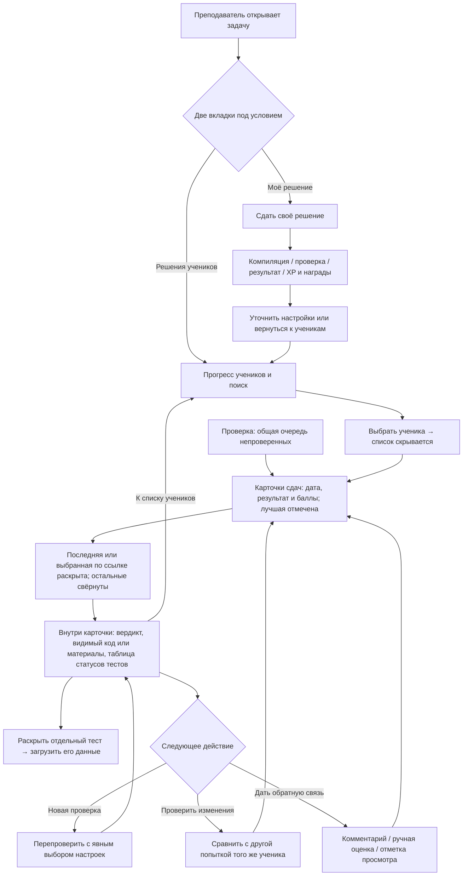
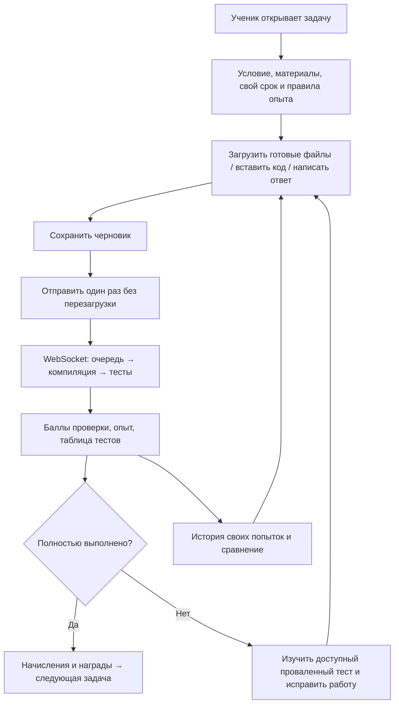

# Задача, сдача и проверка

У преподавателя и ученика разные цели. Преподавателю нужно проверить настройки,
найти ученика и рассмотреть его работу. Ученику — сдать готовую работу, понять
результат и улучшить решение. Личная задолженность преподавателя к этим действиям
не относится.

Что меняется в интерфейсе:

- Даты и правила дедлайна показаны одной цепочкой, без дублирующей отдельной даты.
  Для старого формата без цепочки остаётся дата. Личные статусы «просрочено» и
  «не сдано» предназначены ученику; его обзор дедлайнов сохраняется.
- Список учеников — единственная точка выбора работы. Общая повторная лента всех
  попыток под ним не загружается автоматически. Для выбранного ученика видна
  история всех сдач и открывается последняя; к лучшей можно перейти отдельно.
- Выбор ученика открывает историю и отчёт на всю ширину. Кнопка «К списку учеников»
  возвращает список с сохранёнными поиском и прокруткой. Вкладки используют общий
  компонент оформления системы.
- Преподаватель сдаёт собственную работу через тот же интерфейс и получает обычный
  опыт и награды. Вкладка «Моё решение» хранит его черновик и историю; вкладка
  «Решения учеников» сохраняет выбранного ученика и попытку при переключении. Роль
  преподавателя сама по себе не добавляет его в список учеников курса.
- Сводка попытки разделяет баллы автопроверки и опыт за работу. Это разные данные:
  правила курса и оценка преподавателя могут влиять на опыт.
- Таблица тестов сразу показывает результат каждого теста. Ввод, ожидаемый ответ,
  вывод и ошибки загружаются только при раскрытии конкретного теста. Большие
  данные скачиваются отдельно.
- Первый исходник открыт сразу и показан с подсветкой синтаксиса. Остальные файлы
  выбираются в списке; изображения видны, архивы и таблицы представлены карточками
  с типом, размером и скачиванием. Длинный код прокручивается внутри блока.
- Каждая сдача — отдельная карточка с датой и результатом в заголовке. Раскрытие
  показывает вердикт, код, тесты и действия внутри этой же карточки. Одновременно
  раскрыта одна сдача; сведения об остальных загружаются только при выборе.
  Вторичные операции находятся в меню «Действия».
- Раздел «Проверка» содержит общую очередь, а просмотр и оценивание всегда идут
  на странице задачи. Каноническая ссылка сохраняет `student`, `task`, `attempt`
  и `#task…`; явно выбранная попытка имеет приоритет над последней. Ссылка на
  свою попытку преподавателя открывает вкладку «Моё решение».
- Во время запроса видны загрузка, ошибка и повтор. При быстрой смене ученика или
  попытки запоздавший ответ не заменяет текущий выбор.
- Результат исторической проверки отделён от текущих тестов задачи. Отсутствовавший
  в старом отчёте фактический вывод не восстанавливается догадкой.

Ограничение старой модели: несколько строк оценок могли ссылаться на один
редактируемый фрагмент GeekPaste. Если прежняя версия кода не сохранялась,
история показывает доступные сохранённые попытки; новые версии не выдумываются.
